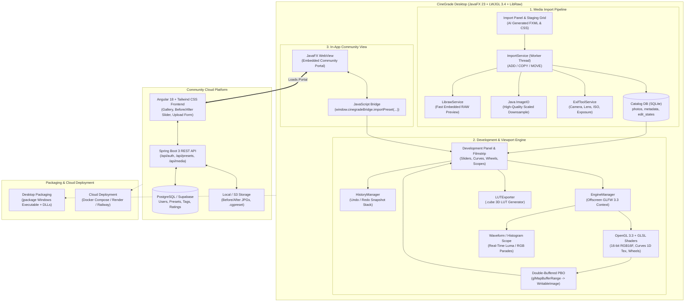
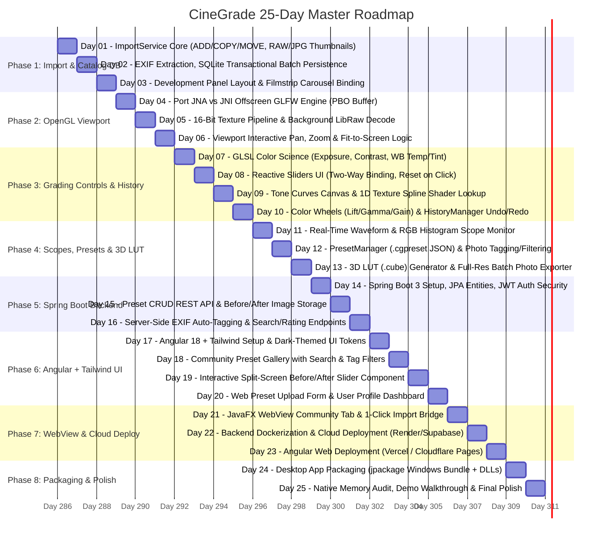

# CineGrade — 25-Day Master Execution & Deployment Plan (Thesis Project)

> **Thesis Title**: *"Komplex, cross-platform asztali digitális színkorrekciós alkalmazás és közösségi platform fejlesztése"*  
> **Target Timeline**: **Up to 25 Days** (Focused engineering sprints).  
> **Strategy**: Accelerated velocity through division of labor:  
> - **AI Ownership**: All UI generation (JavaFX FXML/CSS, Tailwind CSS Angular SPA, custom grading canvases/controls, shaders).  
> - **User Ownership**: Core backend business logic, domain services, and thesis documentation.  
> - **Key Deliverables**: Packaged desktop installer (`jpackage` with native DLLs) + Deployed cloud platform (Dockerized Spring Boot & Angular).

---

## 1. System Ecosystem Architecture



---

## 2. 25-Day Milestone Roadmap



---

## 3. Technical Phase Breakdown & Deliverables

### ── Phase 1: Photo Import Pipeline & SQLite Persistence (Days 1–3) ──

#### **Day 1: Complete `ImportService` Worker & Dual Thumbnail Pipeline**
- **Objective**: Implement asynchronous worker in `ImportService.java` to process `ImportRequest` items.
- **File Handling (`ImportMethod`)**:
  - `ADD`: Retain files in original location on disk.
  - `COPY`: Copy files to `<catalog_dir>/media/<filename>` (with collision resolution).
  - `MOVE`: Move files to `<catalog_dir>/media/<filename>`.
- **Dual Thumbnail Generation**:
  - **RAW Formats**: Call `LibrawService.extractThumbnail()` to extract the embedded camera JPEG preview directly into `<catalog_dir>/cache/thumbnails/<uuid>.jpg` (15–25ms per image).
  - **JPEG / Non-RAW Formats**: Use Java's `ImageIO.read()` -> smooth bilinear downsampling to max 512px dimension -> `ImageIO.write()` JPEG.
- **Deliverable**: `ImportService` processes full batches in background with progress updates.

#### **Day 2: Metadata Extraction & Transactional Batch Persistence**
- **Objective**: Extract EXIF data and commit all records into SQLite in a single transaction.
- **Metadata Extraction**:
  - Call `ExifToolService.readMetaData()` for camera make, model, lens, ISO, aperture, shutter speed, focal length, capture date.
- **Batch DAOs**:
  - `PhotoDao.batchInsert(connection, photos)`: populates `photos` table.
  - `MetadataDao.batchInsert(connection, metadataList)`: populates `photo_metadata` table.
  - `EditstateDao.batchInsert(connection, defaultEditStates)`: populates `edit_states` table.
  - All wrapped inside `connection.setAutoCommit(false)` ... `connection.commit()` for sub-second import performance.
- **Deliverable**: Staged photos appear in SQLite catalog database.

#### **Day 3: Development Panel Shell & Filmstrip Carousel**
- **Objective**: UI layout for `developmentPanel.fxml` and interactive photo filmstrip.
- **UI Structure**:
  - Center: Main viewport `ImageView` backed by `WritableImage`.
  - Bottom: Filmstrip carousel (`HBox` inside `ScrollPane`) rendering thumbnails, active selection highlight, rating stars (0–5), and pick/reject flags.
  - Right: Tabbed / Accordion tool sidebar (Adjustments, Curves, Color Wheels).
  - Left: Library navigator (Folders, Tags, Presets, History).
- **Deliverable**: Clicking a filmstrip item activates the photo in `CatalogContext`.

---

### ── Phase 2: OpenGL/LWJGL Offscreen Viewport Engine (Days 4–6) ──

#### **Day 4: Port `JNA vs JNI` Rendering Engine to CineGrade**
- **Objective**: Create `EngineManager` encapsulating offscreen GLFW context and PBO double-buffered rendering into JavaFX `ImageView`.
- **Offscreen GLFW Setup**:
  - Initialize hidden GLFW window (`GLFW_VISIBLE, GLFW_FALSE`) with OpenGL 3.3 Core profile.
  - Run dedicated daemon rendering thread (`renderThread`).
- **Double-Buffered PBO Pipeline**:
  - Allocate 2 Pack Buffers (`GL_PIXEL_PACK_BUFFER`) sized to viewport dimensions (`width * height * 4` bytes).
  - Asynchronous readback using `glReadPixels(..., GL_BGRA, GL_UNSIGNED_BYTE)` into buffer $i$, while reading buffer $1-i$ using `glMapBufferRange(GL_MAP_READ_BIT)`.
  - Copy BGRA bytes directly to JavaFX `WritableImage.getPixelWriter().setPixels(...)`.
  - Dispatch image swap to JavaFX thread via `Platform.runLater(() -> viewportImageView.setImage(frame))`.
- **Deliverable**: Working GPU render loop streaming frames into JavaFX.

#### **Day 5: 16-Bit Texture Pipeline & Background LibRaw Demosaic**
- **Objective**: Instant photo switching, background 16-bit linear demosaic, and texture upload.
- **Two-Stage Photo Switching**:
  1. Instantly display cached thumbnail in `ImageView` (0ms perceived latency).
  2. Background worker thread decodes full-res RAW via `LibrawService` (`libraw_set_output_bps(16)`, `libraw_set_demosaic(2)`).
  3. Signal render thread via `sourceChanged = true` to upload `GL_RGB16F` texture.
- **Deliverable**: Smooth switching between RAW and JPEG photos without freezing UI.

#### **Day 6: Viewport Navigation (Zoom, Pan, Fit-to-Screen)**
- **Objective**: Professional photo inspection tools.
- **Math & Uniforms**:
  - `u_uvScale`: Zoom factor (1.0 = Fit, 0.5 = 2x, 0.25 = 4x).
  - `u_uvOffset`: Visible pan region in normalized $[0, 1]$ coordinates.
  - Interactive mouse wheel zoom centered at cursor position; mouse drag pan.
- **Deliverable**: Pan & zoom operating at 60fps in the viewport.

---

### ── Phase 3: Color Grading Controls & Non-Destructive History (Days 7–10) ──

#### **Day 7: GLSL Fragment Shader Color Mathematics**
- **Objective**: Professional color grading algorithms implemented directly on the GPU.
- **Shader Operations**:
  - **Exposure**: $C_{out} = C_{in} \cdot 2^{exposure}$.
  - **Contrast**: $C_{out} = (C_{in} - 0.5) \cdot contrast + 0.5$.
  - **Highlights & Shadows Recovery**: Parabolic luminance masking curves.
  - **White Balance**: Correlated Color Temperature (Kelvins) and Tint adjustment via chromatic adaptation.
  - **Saturation & Vibrance**: Vibrance boosts lower-saturated colors while protecting skin tones.
- **Deliverable**: `viewport.frag` shader with complete uniform inputs.

#### **Day 8: Reactive Sliders UI Panel**
- **Objective**: Modern dark-themed adjustment slider components.
- **Features**:
  - Sliders for Exposure, Contrast, Highlights, Shadows, Whites, Blacks, Temp, Tint, Saturation, Vibrance.
  - Numeric text labels with direct editing.
  - Double-click slider or label to reset to default ($0.0$).
  - Two-way binding: Changing slider updates uniform and flags `needsUpdate = true`.
- **Deliverable**: Interactive adjustments panel updating the viewport in real time.

#### **Day 9: Tone Curves Component & 1D GPU Texture Spline**
- **Objective**: RGB and Luma tone curves evaluated on GPU.
- **Architecture**:
  - Interactive canvas (`CurveEditorCanvas`) for manipulating control points across Master (RGB), Red, Green, and Blue channels.
  - Monotone Cubic Spline / Catmull-Rom interpolation evaluated across 256 samples $[0, 255]$.
  - Upload samples as a $256 \times 1$ RGB texture (`GL_RGB8` or `GL_RGB16F`) bound to `sampler2D curveSampler`.
  - GLSL evaluates: `color.r = texture(curveSampler, vec2(color.r, 0.5)).r;`.
- **Deliverable**: Interactive curve editor altering image tonal response in real time.

#### **Day 10: 3-Way Color Wheels (Lift, Gamma, Gain) & HistoryManager**
- **Objective**: Professional color wheels for Shadows, Midtones, and Highlights + Undo/Redo.
- **Color Wheels**:
  - Circular polar puck controls (Shadows = Lift, Midtones = Gamma, Highlights = Gain).
  - Mathematical model:
    $$C_{lift} = C \cdot (Gain - Lift) + Lift$$
    $$C_{gamma} = C_{lift}^{1.0 / Gamma}$$
- **HistoryManager**:
  - Double-ended deque of immutable `EditState` snapshots.
  - Keyboard accelerators (`Ctrl+Z`, `Ctrl+Y`) for Undo and Redo.
  - Debounced auto-save to SQLite `edit_states` and `edit_history`.
- **Deliverable**: Color wheels operational; full undo/redo stack functioning.

---

### ── Phase 4: Scopes, Presets, 3D LUT Export & Batch Rendering (Days 11–13) ──

#### **Day 11: Real-Time Waveform & RGB Histogram Monitor**
- **Objective**: Live signal analysis for exposure and color balance.
- **Pipeline**:
  - Read downsampled viewport PBO pixels ($256 \times 144$) to minimize CPU readback load.
  - Compute 256-bin RGB Histogram and Luma column parade.
  - Draw waveform onto JavaFX `Canvas` overlay or dockable panel.
- **Deliverable**: Waveform scope updating continuously as grading sliders move.

#### **Day 12: PresetManager & Filtering / Tagging Database**
- **Objective**: Save/apply `.cgpreset` files and filter catalog by metadata.
- **Presets**:
  - Export active `EditState` as `.cgpreset` JSON file (including sliders, curves, wheels).
  - Presets sidebar with instant preview and 1-click apply.
- **Tagging & Filtering**:
  - Multi-tag assignment (`TagManager`, `TagBoardController`).
  - Filter filmstrip by Rating ($\ge 3$ stars), Flags (Picked/Rejected), Color Labels, or Tags.
- **Deliverable**: Complete preset saving and catalog filtering operational.

#### **Day 13: 3D LUT (.cube) Generator & High-Res Batch Exporter**
- **Objective**: Export standard 3D LUTs and render final graded images to disk.
- **3D LUT (.cube) Export**:
  - Sample an identity $33 \times 33 \times 33$ or $65 \times 65 \times 65$ RGB lattice.
  - Pass lattice points through the active grading transformation.
  - Write standard `.cube` file compatible with DaVinci Resolve, Premiere Pro, Photoshop.
- **Batch Photo Export**:
  - Choose target format (JPEG / TIFF), resolution, and quality.
  - Offscreen FBO rendering of full-res RAW/JPEG -> write to disk with progress bar.
- **Deliverable**: Export panel exports high-res photos and `.cube` LUT files.

---

### ── Phase 5: Spring Boot Community Backend (Days 14–16) ──

#### **Day 14: Spring Boot 3 Setup, JPA Entities & JWT Security**
- **Objective**: Scalable REST API for user accounts and preset exchange.
- **Entities**:
  - `User`: username, email, passwordHash, avatarUrl, createdAt.
  - `PresetPost`: title, author, description, tags, editParamsJson, likesCount, downloadsCount.
  - `PresetMedia`: presetId, beforeImageUrl, afterImageUrl.
- **Security**: JWT token-based authentication (`/api/auth/register`, `/api/auth/login`).
- **Deliverable**: Spring Boot REST backend running with authenticated endpoints.

#### **Day 15: Preset CRUD & Image Storage Service**
- **Objective**: Manage preset posts and store Before/After preview images.
- **Endpoints**:
  - `GET /api/presets`: paginated preset feed with tag & query filtering.
  - `GET /api/presets/{id}`: detailed view + `.cgpreset` download.
  - `POST /api/presets`: multipart upload (preset JSON + Before/After JPEGs).
- **Deliverable**: Presets can be created, searched, and fetched via REST.

#### **Day 16: Server-Side EXIF Auto-Extraction & Search/Rating Endpoints**
- **Objective**: Automatic metadata categorization and social interactions.
- **Features**:
  - Parse EXIF tags from uploaded sample images to categorize presets by camera make/model.
  - `POST /api/presets/{id}/like`: toggle like.
  - `POST /api/presets/{id}/rate`: submit 1–5 star rating.
- **Deliverable**: Search presets by camera sensor and sort by popularity/rating.

---

### ── Phase 6: Angular + Tailwind CSS Community Platform (Days 17–20) ──

#### **Day 17: Angular 18 + Tailwind Setup & Dark Aesthetic UI Components**
- **Objective**: Modern, responsive web frontend styled with Tailwind CSS.
- **Features**:
  - Angular 18 Standalone components, Tailwind CSS styling matching CineGrade dark aesthetic.
  - Shared UI components: dark cards, badges, modal dialogs, search bars.
- **Deliverable**: Functional frontend shell with navigation and theme.

#### **Day 18: Community Preset Gallery with Search & Filters**
- **Objective**: Preset exploration feed.
- **Features**:
  - Responsive grid of preset cards showing Before/After thumbnail, title, author, rating, and tags.
  - Real-time search bar and category filter chips (Film, Vintage, Portrait, Landscape, Cinematic).
- **Deliverable**: Live browsing of presets with instant filtering.

#### **Day 19: Interactive Before/After Split Slider & Preset Detail View**
- **Objective**: Showcase preset impact with an interactive comparison tool.
- **Features**:
  - Interactive split-screen slider: dragging vertical handle reveals unedited (left) vs graded (right) image.
  - Full preset details, parameter breakdown, camera compatibility badge, and download button.
- **Deliverable**: Smooth interactive before/after comparison component.

#### **Day 20: Web Preset Upload Form & User Profile Dashboard**
- **Objective**: Enable community sharing and user profiles.
- **Features**:
  - Upload form accepting `.cgpreset` JSON, title, description, tags, and Before/After images.
  - User profile showing published presets, received likes, and downloaded presets.
- **Deliverable**: End-to-end preset publishing flow on the web platform.

---

### ── Phase 7: WebView Integration & Cloud Deployment (Days 21–23) ──

#### **Day 21: JavaFX WebView Community Tab & 1-Click Import Bridge**
- **Objective**: Native bridge connecting the web platform directly into CineGrade desktop.
- **Architecture**:
  - Add "Community" tab in CineGrade navigation hosting JavaFX `WebView`.
  - Register Java bridge:
    ```java
    JSObject window = (JSObject) webEngine.executeScript("window");
    window.setMember("cinegradeBridge", new CineGradeWebBridge(catalogContext));
    ```
  - In Angular: "Import into CineGrade" button executes `window.cinegradeBridge.importPreset(presetJson)`.
  - CineGrade receives parameters, saves to local catalog, and applies instantly to active photo!
- **Deliverable**: 1-click cloud preset import working inside desktop application.

#### **Day 22: Backend Dockerization & Cloud Deployment**
- **Objective**: Deploy Spring Boot backend and database to cloud infrastructure.
- **Tasks**:
  - Multi-stage `Dockerfile` for Spring Boot.
  - Deploy PostgreSQL database (e.g. Supabase / Neon).
  - Deploy API to free cloud tier (Render / Railway / Fly.io).
- **Deliverable**: Live public REST API accessible over HTTPS.

#### **Day 23: Angular Web Platform Deployment**
- **Objective**: Deploy Angular frontend to production static hosting.
- **Tasks**:
  - Production build (`ng build --configuration production`).
  - Deploy to Vercel / Cloudflare Pages / Netlify connected to backend API.
- **Deliverable**: Live community web app reachable in any web browser and inside CineGrade WebView.

---

### ── Phase 8: Desktop Packaging, Polish & Thesis Defense (Days 24–25) ──

#### **Day 24: Desktop Application Packaging (`jpackage` Bundling)**
- **Objective**: Standalone executable installer for CineGrade.
- **Packaging Pipeline**:
  - Package Java 21 runtime, JavaFX 23 modules, and native libraries (`libraw.dll`, LWJGL natives) using `jpackage`.
  - Produce standalone Windows `.exe` / `.msi` requiring no external JDK installation.
- **Deliverable**: Self-contained executable installer ready for evaluation.

#### **Day 25: Native Memory Audit, Defense Walkthrough & Final Polish**
- **Objective**: Verify stability, prevent leaks, and prepare thesis demonstration.
- **Checks**:
  - Verify GLFW context releases and LibRaw memory recycling.
  - Execute end-to-end defense script:
    1. Import shoot (mixed RAW + JPEG) -> under 3 seconds.
    2. Real-time grading: Exposure + WB + S-curve + Color Wheels.
    3. Export standard 3D LUT (`.cube`).
    4. Open in-app Community portal -> 1-click import cloud preset.
    5. Batch export high-res deliverables.
- **Deliverable**: Fully verified, crash-free ecosystem with thesis presentation guide.

---

## 4. Shared `.cgpreset` Protocol

The desktop editor and cloud community platform share the exact same JSON schema:

```json
{
  "id": "e3b0c442-98fc-1c14-9afbf4c8996fb924",
  "name": "Kodak Portra 400 Warm",
  "author": "cinegrade_user",
  "version": "1.0",
  "description": "Golden skin tones and gentle film roll-off",
  "tags": ["Film", "Warm", "Portrait", "Vintage"],
  "parameters": {
    "exposure": 0.25,
    "contrast": 1.15,
    "highlights": -0.30,
    "shadows": 0.20,
    "whites": 0.05,
    "blacks": -0.05,
    "temperature": 5800.0,
    "tint": 4.5,
    "saturation": 0.95,
    "vibrance": 1.05,
    "curves": {
      "rgb": [[0,0], [64,55], [128,135], [192,205], [255,255]],
      "red": [[0,0], [255,255]],
      "green": [[0,0], [255,255]],
      "blue": [[0,0], [128,120], [255,255]]
    },
    "wheels": {
      "lift": {"r": 0.02, "g": 0.0, "b": -0.02, "luma": 0.0},
      "gamma": {"r": 0.05, "g": 0.02, "b": -0.03, "luma": 0.0},
      "gain": {"r": 0.08, "g": 0.04, "b": -0.01, "luma": 0.0}
    },
    "lut": null
  },
  "preview": {
    "before_url": "https://storage.cinegrade.app/presets/portra_before.jpg",
    "after_url": "https://storage.cinegrade.app/presets/portra_after.jpg"
  }
}
```

---

## 5. Summary Verification & Defense Checklist

| Step | Feature Under Test | Expected Defense Result |
| :---: | :--- | :--- |
| **1** | Batch Import (RAW + JPG) | Fast preview extraction; thumbnails populate immediately; records saved to SQLite. |
| **2** | Real-time GPU Viewport | 60fps responsive grading feedback on 24MP+ images; zero UI thread freezing. |
| **3** | Tone Curves & Color Wheels | Catmull-Rom spline adjusts tonal balance; 3-way color wheels shift shadows/highlights cleanly. |
| **4** | History & Undo/Redo | `Ctrl+Z` / `Ctrl+Y` revert and reapply grades instantly without data loss. |
| **5** | 3D LUT Export | Generated `.cube` file loads seamlessly into Photoshop / DaVinci Resolve with identical look. |
| **6** | Web Community Platform | Responsive Tailwind UI; interactive Before/After split slider functions in browser. |
| **7** | In-App 1-Click Cloud Sync | Clicking preset in desktop WebView instantly downloads and applies look to active photo. |
| **8** | Standalone Packaging | Desktop app launches from `.exe` bundle without pre-installed JDK or external tooling. |
